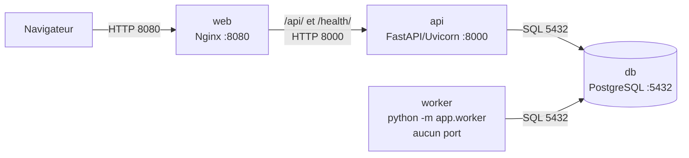
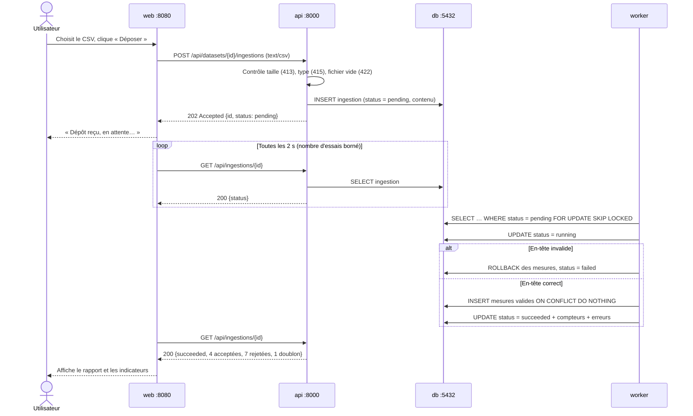

# Tâche 6 - Dessiner l'architecture

Les diagrammes modifiables sont dans ce dossier (à ouvrir avec draw.io) :

| Fichier | Diagramme |
|---|---|
| `1-composants.drawio` | Composants et ports |
| `2-sequence-depot.drawio` | Séquence d'un dépôt |
| `3-deploiement.drawio` | Déploiement : poste, Compose, k3d, AWS |
| `architecture.drawio` | Les trois diagrammes réunis (une page chacun) |

Les versions Mermaid ci-dessous s'affichent directement sur GitHub et dans VS Code.

## 1. Composants

| Composant | Port | Rôle |
|---|---|---|
| web (Nginx) | 8080 | Sert l'interface et relaie `/api/` et `/health/` vers l'API. Seul point d'entrée du navigateur. |
| api (FastAPI / Uvicorn) | 8000 | Reçoit les requêtes, enregistre les jeux et les dépôts, calcule les indicateurs. |
| db (PostgreSQL) | 5432 | Seul composant qui conserve les données. |
| worker | aucun | Ne reçoit aucune requête : interroge la base pour traiter les dépôts `pending`. |

Seul **web** est exposé sur le poste. **api** et **db** restent sur le réseau interne.

## 2. Séquence d'un dépôt

## 3. Déploiement

```mermaid
flowchart TB
    subgraph DEV["S1-S2 : poste (compose.dev.yaml)"]
        direction LR
        b1[Navigateur] -->|127.0.0.1:8080| w1[web conteneur :8080]
        w1 -->|host.docker.internal:8000| a1[api sur le poste :8000]
        a1 -->|127.0.0.1:5432| d1[(db conteneur :5432<br/>volume devpgdata)]
    end
    subgraph COMPOSE["S3 : Docker Compose (compose.yaml)"]
        direction LR
        b2[Navigateur] -->|127.0.0.1:8080| w2[web :8080]
        w2 -->|api:8000| a2[api :8000]
        a2 -->|db:5432| d2[(db :5432<br/>volume pgdata)]
        k2[worker] -->|db:5432| d2
    end
    subgraph K3D["S4 : Kubernetes k3d (namespace campusdata)"]
        direction LR
        b3[Navigateur] -->|127.0.0.1:8081| i3[Ingress Traefik]
        i3 --> w3[Service web :8080]
        w3 -->|api:8000| a3[Deployment api :8000]
        a3 -->|db:5432| d3[(db :5432<br/>PVC)]
        c3[CronJob ingest<br/>worker --once / 1 min] -->|db:5432| d3
    end
    subgraph AWS["S5-S6 : K3s sur EC2 AWS"]
        direction LR
        b4[Navigateur] -->|tunnel SSH 127.0.0.1:8082| i4[Ingress Traefik]
        i4 --> w4[web :8080] --> a4[api :8000] --> d4[(db :5432<br/>PVC sur la VM)]
        c4[CronJob ingest] --> d4
    end
```

| Contexte | Entrée utilisateur | Accès API | DB depuis l'API | Worker | Stockage |
|---|---|---|---|---|---|
| Développement (S1-S2) | `127.0.0.1:8080` | `host.docker.internal:8000` | `127.0.0.1:5432` | sur le poste | volume `devpgdata` |
| Compose (S3) | `127.0.0.1:8080` | `api:8000` | `db:5432` | conteneur en boucle (5 s) | volume `pgdata` |
| k3d (S4) | `127.0.0.1:8081` | Service `api:8000` | `db:5432` | CronJob `--once` chaque minute | PVC |
| AWS/K3s (S5-S6) | `127.0.0.1:8082` par tunnel SSH | Service `api:8000` | `db:5432` | CronJob `--once` chaque minute | PVC sur le disque de la VM |

## Trois décisions

| Décision | Choix | Raison |
|---|---|---|
| **PostgreSQL partout**, y compris pour les dépôts en attente | Les dépôts en attente sont des lignes `pending` dans la table `ingestions`, sans outil de file séparé (Redis, RabbitMQ). | Un seul service à installer, sauvegarder et surveiller. Le verrou `FOR UPDATE SKIP LOCKED` empêche deux workers de traiter le même dépôt. |
| **Worker séparé** plutôt qu'un traitement dans la requête HTTP | L'API répond 202 tout de suite ; un autre processus traite le fichier ensuite. | Un gros fichier ne bloque pas l'API, et un plantage du traitement ne la rend pas indisponible. Un dépôt `failed` peut être relancé (US09). |
| **Contrainte d'unicité** (`dataset_id`, `room`, `measured_at`) | La base refuse elle-même les doublons (`ON CONFLICT DO NOTHING`). | Redéposer le même fichier n'ajoute aucune mesure (US07). La protection tient même si deux workers ou un bug tentent d'insérer deux fois. |
